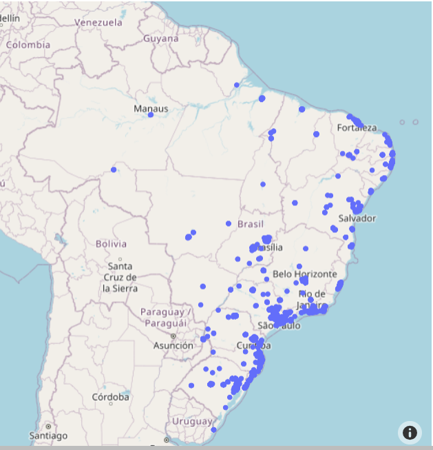

# Exploratory Data Analysis: Brazilian Real Estate Market
An exploratory data analysis investigating how property size (`area_m2`) and geographic location influence residential property prices (`price_usd`) across Southern Brazil.

## Key Findings
* **Market Volume:** Rio Grande do Sul had the highest volume of listings (2,643), followed closely by Santa Catarina (2,634) and Paraná (2,544).
* **Price vs. Area Correlation:** Property size shows a moderate positive correlation with price across all three states, strongest in **Rio Grande do Sul ($r = 0.58$)**, followed by **Paraná ($r = 0.54$)** and **Santa Catarina ($r = 0.51$)**.

## Visualizations

## Tools Used
* **Python** (Pandas, Matplotlib)
* **JupyterLab**
